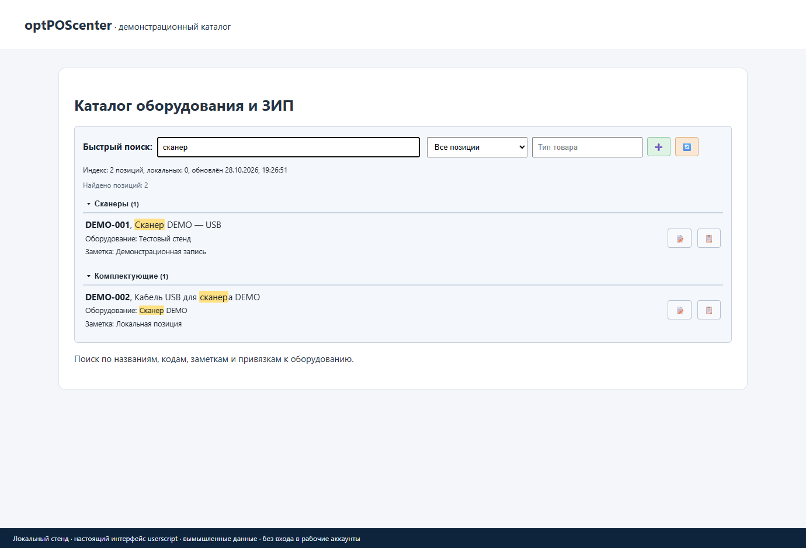

# optPOScenter — быстрый каталог оборудования и ЗИП

**Tampermonkey · 0.2.8 · Jeronimo701**

Панель поиска поверх [optposcenter.ru](https://optposcenter.ru): ищет по названию, коду 1С, модели, оборудованию и заметкам. Свои позиции можно добавить локально, не меняя каталог на сервере.

[Установить скрипт](https://raw.githubusercontent.com/jeronimo701/Optposcenter-catalog-plus/main/Optposcenter_catalog_plus.user.js) · [Изменения](CHANGELOG.md) · [Сообщить о проблеме](https://github.com/jeronimo701/Optposcenter-catalog-plus/issues)

*Настоящий интерфейс скрипта на локальной тестовой странице, с вымышленными данными. Это не снимок рабочего аккаунта или реального каталога сайта.* [Добавление локальной позиции](docs/screenshots/local-item.png)

## Что умеет

- Фильтры оборудования, ЗИП, локальных позиций и типов товара.
- Локальный индекс для поиска и обновление из каталога.
- Заметки и привязки к оборудованию, просмотр карточек и фото.
- Добавление своих позиций, импорт и экспорт JSON.
- Опциональный автоматический вход с локально сохранёнными реквизитами.

## Установка и первый запуск

1. Установи [Tampermonkey](https://www.tampermonkey.net/) в поддерживаемый браузер.
2. Нажми **«Установить скрипт»** выше и подтверди установку в расширении.
3. Войди в свой аккаунт optPOScenter обычным способом и открой каталог.
4. Дождись индексации либо запусти «Обновить индекс каталога» из меню Tampermonkey.
5. Ищи название или код; используй фильтры. Кнопка «+» добавляет локальную позицию.
6. Перед переносом настроек сохрани экспорт локальных позиций.

Не включай одновременно несколько старых копий этого скрипта.

## Обновления

Автообновление настроено: `@updateURL` ведёт на небольшой `.meta.js`, `@downloadURL` — на актуальный `.user.js` в этом публичном репозитории. GitHub-вход и токен не нужны.

**Если раньше стояла копия с `@updateURL none`, её нужно один раз переустановить по ссылке выше.** Такая копия сама не узнает новый адрес. `@name` и `@namespace` сохранены; перед переустановкой сделай резервную копию настроек средствами Tampermonkey. Дальше проверь, что автоматическая проверка обновлений включена в расширении; мгновенное уведомление не гарантируется.

[Как устроены updateURL и downloadURL](https://www.tampermonkey.net/documentation.php#meta:updateURL).

## Что важно знать

Доступ к каталогу определяется аккаунтом сайта. Индекс и локальные позиции не синхронизируются автоматически между компьютерами. При изменении разметки или экспорта сайта индексацию может потребоваться обновить.

### Логин, пароль и внешние компоненты

Автовход необязателен. При его включении логин и пароль сохраняются в хранилище Tampermonkey, а не в защищённом менеджере паролей. Не передавай экспорт этих данных. Для чтения таблиц загружается `xlsx` 0.18.5 с jsDelivr; просмотр заголовков видео может обращаться к YouTube/Rutube.

## Проверка и разработка

На локальном стенде проверены поиск по вымышленному индексу и окно локальной позиции. Вход, загрузка реального каталога и запись данных в рабочем аккаунте не выполнялись.

После изменения кода повысь `@version`, выполни `python tools/sync_meta.py` и `python -m unittest discover -s tests -v`, затем отправь `.user.js` и `.meta.js` вместе. Проверка синтаксиса: `node --check Optposcenter_catalog_plus.user.js`.

## Условия использования

Самостоятельная доработка, не официальный продукт владельца сайта. Условия собственного кода: [LICENSE.txt](LICENSE.txt), область — [LICENSE-SCOPE.md](LICENSE-SCOPE.md). Разрешено бесплатное личное некоммерческое использование физическими лицами; использование организациями и продажа требуют отдельного разрешения. Это source-available, не MIT/GPL.

История переноса сохранена в Git и [историческом README](README-GIST-HISTORICAL.md); прежние ссылки Gist не являются установочными.
